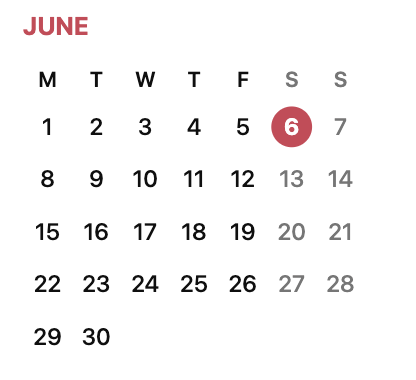
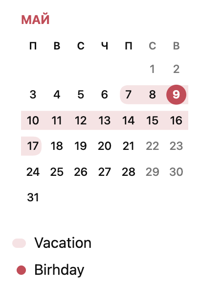
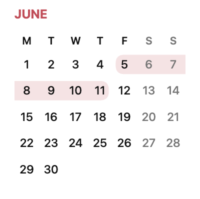
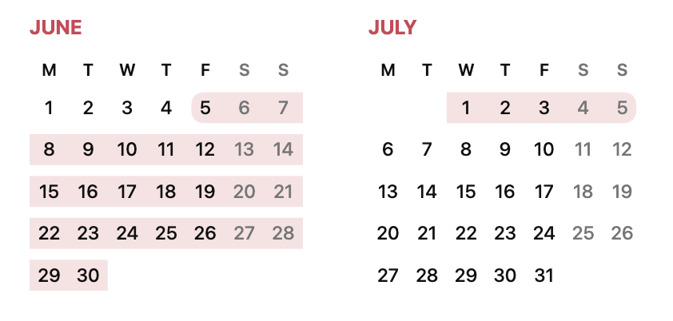
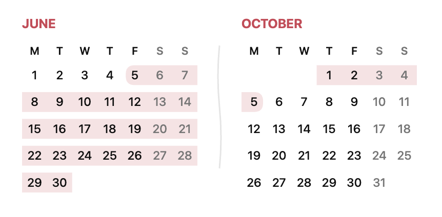

# Calendar Blocks

Calendar Blocks is an Obsidian plugin for rendering dates and date ranges as
calendars.

## Examples

### Single date

````
```date
2026.06.06
```
````



### Legend

````
```dates
Vacation: 7 May 2027 - 17 May
Birhday: 9 May
```
````



### Range within one month

````
```date
2026.06.05 - 2026.06.11
```
````



### Range across adjacent months

````
```date
2026.06.05 - 2026.07.05
```
````



### Range with omitted months

````
```date
2026.06.05 - 2026.10.05
```
````



## Usage

Use a fenced `date` code block for a single date:

````markdown
```date
2025.07.27
```
````

The `dates` block name is supported as an alias and has identical behavior.

Use a hyphen between two dates for a range:

````markdown
```date
2025.07.27 - 2025.08.03
```
````

### Multiple ranges and dates

Put each range or single date on its own line in the same block:

````markdown
```dates
2026.06.05 - 2026.06.11
2026.06.09 - 2026.06.15
2026.06.10
2026.07.03 - 2026.08.05
```
````

All entries appear together. Ranges and single dates use two independent pools
of the same 40-color palette, each starting with red, blue, and green in source
order. The first single date and the first range are both red; adding a single
date does not advance the range colors, and vice versa. A range with identical
endpoints collapses into a single date: it uses a circle, a color from the
single-date pool, and a circle in the legend. Each entry keeps its color
across weeks and months. Overlapping ranges retain their translucent layers,
so their colors blend at intersections. Single dates appear as colored circles above all ranges,
regardless of line order. Blank lines are ignored; an invalid entry reports its
line number and rejects the whole block.

A block accepts up to 40 entries in total; adding a 41st range or single date
shows an error. Blank lines do not consume colors or count toward the limit.

Months are shown once, in chronological order, adding the endpoint months of
each range and the months of single dates. Long ranges still show their first
and last months, with a wave at each gap. Additional months form rows of two
calendars and stack vertically in narrow panes.

### Legend

Add a label followed by a colon before a range or single date:

````markdown
```dates
Vacation: 1 Mar - 9 Mar
Conference: 5 Mar - 7 Mar
Birthday: 8 Mar
```
````

The legend appears below all calendars, with one labeled entry per line and a
marker on the left. Ranges use a pill about 1.47 times as wide as a single-date circle,
matching the range's color and transparency. Single dates use solid circles.
Markers share a column and align to its right edge, keeping all labels aligned.
Unlabeled entries are omitted from the
legend but still consume a color from their type's pool. If no entries have labels, no
legend is shown. Labels support plain text, including spaces and Unicode.

### Supported date formats

Dates accept one- or two-digit days and months:

- Year first: `2026.03.02`, `2026-03-02`, `2026/3/2`.
- Day first: `02.03.2026`, `2/3/2026` (always day/month/year).
- Month names in the system locale and Obsidian language, case-insensitive:
  full names, abbreviations (with or without a trailing period), and grammatical
  forms used in dates, such as `1 марта`, `1 март`, or `1 мар.` in Russian.
  English names (`2 Mar 2026`, `2 March 2026`) are always accepted.
- Without a year: `2.3`, `02/03`, `2 Mar`.

For the first entry, when a single date or both range endpoints omit their years, the plugin uses the source
note's creation year (Obsidian's file creation timestamp). It does not use the
current year or the last modification year. If both range years are omitted,
the creation year determines the start year and the end may roll into the next year.
If the source note is unavailable, specify the year of the first single date or either
endpoint of the first range explicitly.

A range end without a year uses the start's year, advancing to the next year
when its month/day would fall before the start. For example,
`28 Dec 2005 - 1 Jan` ends on January 1, 2006, independently of the note's creation
year. Conversely, `28 Dec - 1 Jan 2006` starts on December 28, 2005: an omitted
start year uses the end's year, moving back one year if its month/day would fall
after the end. Explicit years are always respected.

For subsequent entries, a single date without a year (or the start of a range
with both years omitted) uses the year that places it closest to the interval
from the earliest to the latest previously resolved date in the block. Dates
inside that interval have zero distance; ties choose the earliest occurrence.
This takes precedence over the note creation year. Each resolved entry expands
the interval, and blank lines do not reset it. A yearless February 29 uses the
nearest valid leap year. Explicit years and inference from the other endpoint
of the same range retain priority.

For example, `Vacation: 7 May 2027 - 17 May` followed by `Birthday: 9 May`
puts all dates in 2027. With `30 Dec 2010 - 7 Jan`, the range ends in 2011;
a following `9 Jan` resolves to 2011, while `5 Dec` resolves to 2010.

For example, in a note created in 2026:

````markdown
```date
1 Mar - 4 Apr
```
````

This selects March 1 through April 4, 2026. Formats can be mixed within a
range; hyphens, en dashes and em dashes are accepted as separators. Invalid
calendar dates and reversed ranges with explicit years are rejected. Ranges
crossing New Year can omit the end year, for example `31 Dec 2026 - 1 Jan`.

## Settings

Calendars use the grid-free Minimal design with narrow weekday labels and a
filled circle for a single selected date.

Enable **Stretch calendar** in the Calendar Blocks settings to make calendars
use the full available note width. It is disabled by default, preserving the
compact layout.

## Installation

### Manual installation from Releases

1. Open the [latest release](https://github.com/pochemuto/calendar-blocks/releases/latest)
   and download the attached `main.js`, `manifest.json`, and `styles.css` files. Do not
   download GitHub's automatically generated source code archives.
2. Create this directory inside your Obsidian vault:

   ```text
   <vault>/.obsidian/plugins/calendar-blocks/
   ```

3. Copy the three downloaded files directly into that directory. The resulting
   layout must be:

   ```text
   <vault>/.obsidian/plugins/calendar-blocks/
   ├── main.js
   ├── manifest.json
   └── styles.css
   ```

4. Reload Obsidian, open **Settings → Community plugins**, and enable
   **Calendar Blocks**.

## Build

```sh
npm ci
npm run build
```

Copy the contents of `build/` to:

```text
<vault>/.obsidian/plugins/calendar-blocks/
```

Then reload Obsidian and enable **Calendar Blocks** in the community plugins
settings.

## Publishing

Before publishing, run `npm test`, `npm run build`, and `git diff --check`.
Keep the version in `manifest.json`, `package.json`, and `package-lock.json`
in sync, and record its minimum Obsidian version in `versions.json`.
The minimum supported Obsidian version is 1.5.7, which introduced the
`Vault.getFileByPath` API used to resolve the source note.

Create a Git tag that exactly matches the manifest version, without a `v`
prefix (for example, `0.1.1`). Pushing that tag runs CI and publishes a GitHub
release with only `main.js`, `manifest.json`, and `styles.css` as attached assets.
Append a concise, readable bullet to [CHANGELOG.md](CHANGELOG.md) when committing
a change. Keep it as a flat list, with one entry per line and no version sections.
CI generates the release description from added bullet lines in the changelog
diff since the previous release tag, preserving file order and removing duplicates.
The first release, or the first release with a changelog, includes all its entries.
Both current tags (`0.1.1`) and legacy tags (`v0.1.0`) delimit the diff.

Before publishing the release, CI generates GitHub build provenance attestations
for the three individual plugin assets. The signing permissions are restricted
to the release job, which runs only for version tags after tests and the build
succeed. Verify downloaded assets with the GitHub CLI:

```sh
gh attestation verify main.js --repo pochemuto/calendar-blocks
gh attestation verify manifest.json --repo pochemuto/calendar-blocks
gh attestation verify styles.css --repo pochemuto/calendar-blocks
```

The initial directory submission is made through
[Obsidian Community](https://community.obsidian.md) after signing in and
connecting the repository owner's GitHub account. Subsequent updates use
GitHub releases. See the official
[submission guide](https://docs.obsidian.md/Plugins/Releasing/Submit%20your%20plugin).

## License

[MIT](LICENSE).

## Visual regression tests

`npm test` runs unit tests and 56 screenshot comparisons (28 cases in light and
dark themes). Visual tests require a running Docker engine. The first run
downloads the pinned Playwright image. Local runs and CI use the same Linux
arm64 image, Chromium version, bundled Noto Sans font, locale, timezone and
pixel density; no host fonts or Obsidian installation are needed.

```sh
npm ci
npm test
# Run just one suite:
npm run test:unit
npm run test:visual
# Filter visual cases:
npm run test:visual -- --grep omitted-months
```

Reference PNGs live in `tests/test-data/visual/linux/` and belong in Git.
Every pixel must match: both the color threshold and allowed differing pixel
count are zero. An additional decoded RGBA comparison includes antialiased
pixels that Playwright's comparator can ignore. Missing references fail a normal test run. On failure,
`test-results/` contains expected, actual and diff images, and
`npm run test:visual:report` opens the HTML report. CI uploads these artifacts.

After an intentional visual change, explicitly regenerate references:

```sh
npm run test:visual:update
# Or update only the affected cases:
npm run test:visual:update -- --grep legend
```

Review the changed PNGs before accepting them, then rerun `npm test`.
The input fixtures live in `tests/test-data/visual/*.md`. Each Markdown file
has the same name as its PNG (for example, `adjacent-months-light.md`), contains
one fenced `date` or `dates` block, and embeds both light and dark reference
images using relative links. Open it on GitHub to see the input and output
together. The filename suffix (`-light` or `-dark`) determines the tested theme.

Optional fixture settings go in YAML frontmatter at the start of the file:

```yaml
---
width: 280
locale: ru
stretch: true
---
```

Defaults are width 640, locale `en-US`, and stretching disabled; the source
note creation year is fixed at 2026. To add a scenario in both themes, add
`<name>-light.md` and `<name>-dark.md` with the input, settings and image links,
then run `npm run test:visual:update`. There is no separate case list in code.
Unit tests validate the Markdown format, both screenshot embeds and their
relative paths, existing PNG targets, and a matching Markdown file for every
reference image. Broken, missing, duplicate or swapped image links fail tests.
Keep the Docker image version in `tests/visual/run.mjs` aligned with the exact
`@playwright/test` dependency. Browser or font upgrades may require reviewed
reference updates.

The harness uses the production parser, renderer and stylesheet with fixed
Obsidian theme variables. It covers responsive container queries, highlight
layers, legends, localization, month lengths, year boundaries, stretching and
all 40 selection colors. These tests exercise the shared calendar rendering;
Live Preview/Reading integration and third-party Obsidian themes still need
manual checking in Obsidian.
