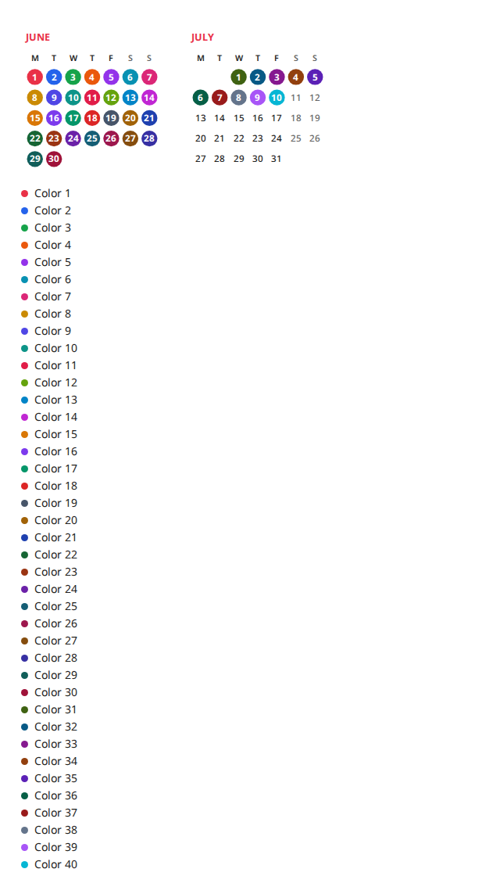
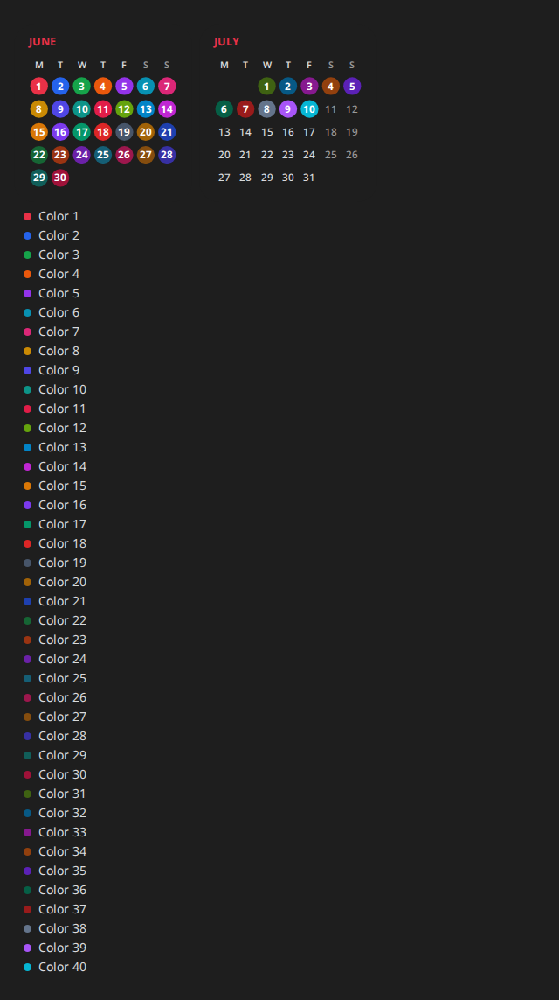

```dates
Color 1: 1 Jun
Color 2: 2 Jun
Color 3: 3 Jun
Color 4: 4 Jun
Color 5: 5 Jun
Color 6: 6 Jun
Color 7: 7 Jun
Color 8: 8 Jun
Color 9: 9 Jun
Color 10: 10 Jun
Color 11: 11 Jun
Color 12: 12 Jun
Color 13: 13 Jun
Color 14: 14 Jun
Color 15: 15 Jun
Color 16: 16 Jun
Color 17: 17 Jun
Color 18: 18 Jun
Color 19: 19 Jun
Color 20: 20 Jun
Color 21: 21 Jun
Color 22: 22 Jun
Color 23: 23 Jun
Color 24: 24 Jun
Color 25: 25 Jun
Color 26: 26 Jun
Color 27: 27 Jun
Color 28: 28 Jun
Color 29: 29 Jun
Color 30: 30 Jun
Color 31: 1 Jul
Color 32: 2 Jul
Color 33: 3 Jul
Color 34: 4 Jul
Color 35: 5 Jul
Color 36: 6 Jul
Color 37: 7 Jul
Color 38: 8 Jul
Color 39: 9 Jul
Color 40: 10 Jul
```

Linux Light



Linux Dark


